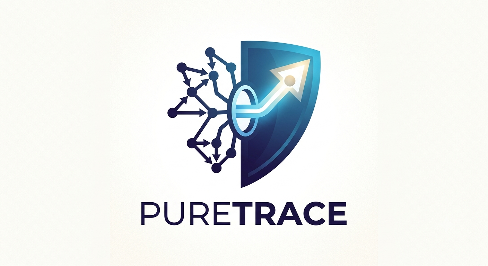

  

# PureTrace

> **Killing the 91% Noise:** A Taint-Aware RAG Pipeline That Turns Static Analysis Into an Intelligent Vulnerability Hunter for Cloud and Embedded Systems

---

## Coming Soon

The open-source repository, technical whitepaper, and Black Hat India briefing materials are currently being prepared for release.

  <b>Shaunak Chattopadhyay</b>

