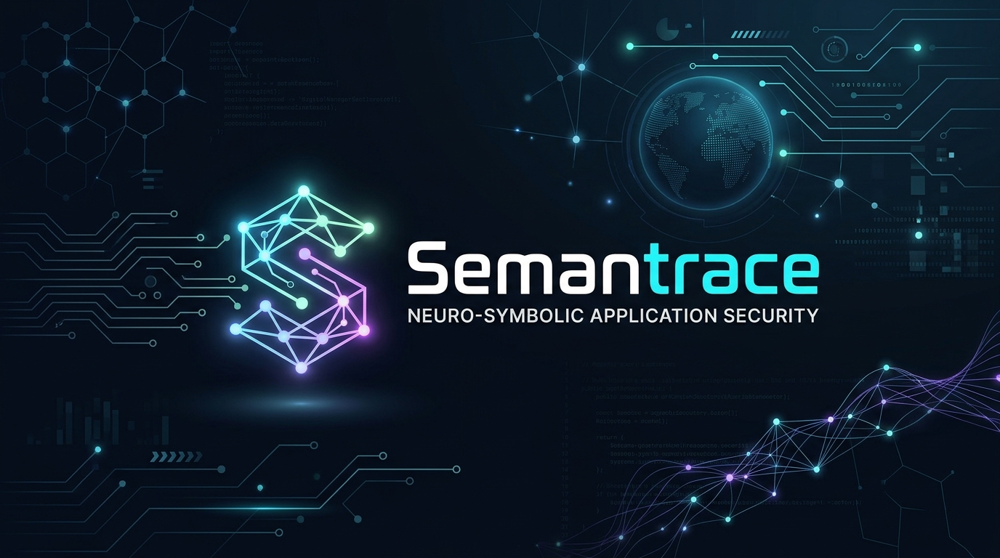

<div class="hero-wrapper">
<div class="hero-banner">
<div class="hero-logo-wrapper">

</div>
<div class="hero-meta-badges">
<span class="meta-badge highlight">Black Hat India 2026</span>
<span class="meta-badge">Technical White Paper</span>
<span class="meta-badge">November 2026</span>
<span class="meta-badge">Cloud &amp; Embedded Systems</span>
</div>
<h1 class="hero-title">
<span class="gradient-text">Semantrace</span>: Killing the 91% Noise
</h1>
<p class="hero-subtitle">
A Taint-Aware RAG Pipeline That Turns Static Analysis Into an Intelligent Vulnerability Hunter for Cloud and Embedded Systems
</p>
<div class="hero-byline">
<strong>Shaunak Chattopadhyay</strong><br>
<a href="https://semantrace.github.io">semantrace.github.io</a>
</div>
<div class="hero-actions">
<a href="#abstract" class="btn-action btn-primary">
<svg width="16" height="16" viewBox="0 0 24 24" fill="none" stroke="currentColor" stroke-width="2"><path d="M2 3h6a4 4 0 0 1 4 4v14a3 3 0 0 0-3-3H2z"></path><path d="M22 3h-6a4 4 0 0 0-4 4v14a3 3 0 0 1 3-3h7z"></path></svg>
Read Whitepaper
</a>
<a href="#5-empirical-evaluation--benchmarks" class="btn-action btn-secondary">
<svg width="16" height="16" viewBox="0 0 24 24" fill="none" stroke="currentColor" stroke-width="2"><line x1="18" y1="20" x2="18" y2="10"></line><line x1="12" y1="20" x2="12" y2="4"></line><line x1="6" y1="20" x2="6" y2="14"></line></svg>
Benchmarks
</a>
<a href="#citation" class="btn-action btn-secondary">
<svg width="16" height="16" viewBox="0 0 24 24" fill="none" stroke="currentColor" stroke-width="2"><rect x="9" y="9" width="13" height="13" rx="2" ry="2"></rect><path d="M5 15H4a2 2 0 0 1-2-2V4a2 2 0 0 1 2-2h9a2 2 0 0 1 2 2v1"></path></svg>
Cite Paper
</a>
</div>
</div>

<div class="briefing-card" id="black-hat-briefing">
<div class="briefing-header">
<span class="briefing-pill">Black Hat India • Official Briefing</span>
<span class="briefing-title">Briefing Session &amp; Research Presentation</span>
</div>
<p>
This technical whitepaper outlines the architecture and empirical findings presented at <strong>Black Hat India</strong> in the briefing session:
<strong><em>"Killing the 91% Noise: A Taint-Aware RAG Pipeline That Turns Static Analysis Into an Intelligent Vulnerability Hunter for Cloud and Embedded Systems"</em></strong> (Speaker: <strong>Shaunak Chattopadhyay</strong>).
</p>
<p>
The session demonstrates how traditional static analysis false-positive noise can be systematically eliminated by combining deterministic boundary gating with bounded neural verification, modeling cyber-physical interfaces (CAN bus, BLE GATT, UART ISRs, OCPP) as first-class taint surfaces. Briefing slide decks, demonstration walkthroughs, and research materials accompany the release.
</p>
<div style="display: flex; flex-wrap: wrap; gap: 0.75rem; align-items: center; margin-top: 1rem;">
<a href="https://www.blackhat-india.com/briefings-schedule?day=friday#killing-the-91-noise-a-taint-aware-rag-pipeline-that-turns-static-analysis-into-an-intelligent-vulnerability-hunter-for-cloud-and-embedded-systems-50020" target="_blank" rel="noopener noreferrer" class="btn-action btn-primary" style="padding: 0.45rem 1rem; font-size: 0.84rem;">
<svg width="15" height="15" viewBox="0 0 24 24" fill="none" stroke="currentColor" stroke-width="2"><path d="M18 13v6a2 2 0 0 1-2 2H5a2 2 0 0 1-2-2V8a2 2 0 0 1 2-2h6"></path><polyline points="15 3 21 3 21 9"></polyline><line x1="10" y1="14" x2="21" y2="3"></line></svg>
View on Official Black Hat India Schedule ↗
</a>
<span style="font-size: 0.82rem; color: var(--text-muted); font-family: var(--font-mono);">Session ID: 50020 • Friday Track</span>
</div>
</div>

<div class="stat-grid">
<div class="stat-card">
<div class="stat-value stat-cyan">91%</div>
<div class="stat-label">Static Noise Slashed</div>
<div class="stat-sub">From raw AST alerts to verified exploitability</div>
</div>
<div class="stat-card">
<div class="stat-value stat-emerald">100%</div>
<div class="stat-label">Critical CWE Recall</div>
<div class="stat-sub">CWE-122 Heap Overflow &amp; CWE-297 TLS</div>
</div>
<div class="stat-card">
<div class="stat-value stat-indigo">180</div>
<div class="stat-label">Public CVEs Benchmarked</div>
<div class="stat-sub">Official cURL Security Suite (2000–2026)</div>
</div>
<div class="stat-card">
<div class="stat-value stat-amber">$0.00</div>
<div class="stat-label">Clean Commit Overhead</div>
<div class="stat-sub">Deterministic gating exits on clean PRs</div>
</div>
</div>

<hr class="section-divider" />
</div>

<main class="main-article content-body">

<h2 id="abstract">Abstract</h2>

<div class="abstract-box">
<p>
Static Application Security Testing (SAST) has historically been governed by an unyielding trade-off: fast, deterministic static pattern matching produces unmanageable false-positive rates (frequently reaching 70% to over 90%), while deep formal methods (e.g., interprocedural path analysis and model checking) suffer from state-space explosions and steep computational overhead. Recent efforts to deploy Large Language Models (LLMs) as zero-shot code auditors attempt to bypass these limits, but introduce critical failure modes: high hallucination rates, non-deterministic outputs, and token costs that scale linearly with codebase size ($\mathcal{O}(N)$). Furthermore, existing analysis engines are architected almost exclusively for POSIX and web-application environments, leaving cyber-physical, bare-metal, and embedded protocol boundaries unmodeled.
</p>
<p>
This whitepaper presents <strong>Semantrace</strong>, a cascaded neuro-symbolic security analysis architecture designed to resolve the <em>Precision–Recall–Cost Trilemma</em>. Semantrace establishes a gated pipeline that inverts traditional AI-for-code paradigms: rather than using probabilistic models to discover bugs, deterministic symbolic automata act as strict, cost-bounding gates ($\mathcal{O}(K)$ candidate witnesses), while a specialized neural reasoning engine acts as a bounded semantic oracle to prove or refute reachability and exploitability. Semantrace models cyber-physical inputs (CAN bus, BLE GATT, UART ISRs, OCPP) as first-class taint boundaries, constructs topology-aware call-graph slices to condition LLM reasoning, and mathematically computes CVSS 3.1 scores from discrete categorical vectors. Across benchmark evaluations on the official cURL security corpus (180 historical CVEs) and open-source embedded targets, Semantrace maintains high recall while eliminating LLM inference spend on over 75% of clean commits.
</p>
</div>

---

<h2 id="1-the-program-analysis-trilemma">1. The Program Analysis Trilemma</h2>

Automated vulnerability discovery tools are fundamentally constrained by Rice's Theorem: any non-trivial semantic property of a computer program is formally undecidable. Production security teams must navigate the **Precision–Recall–Cost Trilemma**:

```
                       High Recall
                    (Syntactic SAST)
                          ▲
                         / \
                        /   \
                       /     \
                      /       \
        High Precision ───────── Low Compute Cost
       (Deep SMT / LLM)         (Deterministic Gates)
```

1. **Syntactic Static Analysis (Regex / Heuristic AST):** Fast, easily parallelized, and provides broad recall. However, lack of data-flow semantics and path-sensitivity results in false-positive rates frequently exceeding 70–90%, inducing alert fatigue and broken developer trust.
2. **Deep Semantic Analysis (Datalog / Model Checking / SMT):** Sound and precise, but computationally prohibitive on large codebases. Requires complete, buildable compilation units—a condition frequently unmet in distributed microservices and heterogeneous firmware toolchains.
3. **Pure Neural Scanning (LLM-as-a-Judge):** Demonstrates high semantic intuition on local code blocks, but exhibits unbounded hallucinations, misses global context, and induces unsustainable cloud inference costs when processing large repositories or high-velocity CI/CD pipelines.

### The Cyber-Physical Blind Spot
Beyond computational complexity, existing SAST tooling suffers from an acute domain blind spot: **embedded and cyber-physical systems**. Mainstream scanners assume POSIX interfaces (e.g., `argv`, `stdin`, socket descriptors, HTTP endpoints). They possess no formal models for:
* Hardware registers and Memory-Mapped I/O (MMIO).
* Industrial and automotive serial buses (CAN/CAN-FD, UART, SPI, I2C).
* Real-Time Operating System (RTOS) task scheduling and Interrupt Service Routines (ISRs).
* Short-range wireless and IoT transport specifications (BLE GATT tables, OCPP, MQTT).

When firmware is audited with conventional web-oriented tooling, critical hardware-boundary vulnerabilities are either missed entirely or misclassified.

---

<h2 id="2-high-level-architectural-paradigm">2. High-Level Architectural Paradigm</h2>

Semantrace is founded on a core architectural principle: **Symbolic models must govern search and cost; neural models must govern semantic verification.**

```
┌─────────────────────────────────────────────────────────────────────────────┐
│                    The Cascaded Semantrace Pipeline                         │
├─────────────────────────────────────────────────────────────────────────────┤
│                                                                             │
│  [Codebase / Commit Diff]                                                   │
│           │                                                                 │
│           ▼                                                                 │
│  ┌─────────────────┐                                                       │
│  │ 1. Static Gate  │ ── (0 Hits) ──► [Exit: $0 Inference Cost]              │
│  └────────┬────────┘                                                       │
│           │ (>0 Hits)                                                       │
│           ▼                                                                 │
│  ┌─────────────────┐                                                       │
│  │ 2. AST Slicing  │ ──► Multi-Language Syntax Boundary Extraction          │
│  └────────┬────────┘                                                       │
│           │                                                                 │
│           ▼                                                                 │
│  ┌─────────────────┐                                                       │
│  │ 3. Topology &   │ ──► Backward Call Reachability (Sink ◄── Source)       │
│  │    Taint Path   │                                                        │
│  └────────┬────────┘                                                       │
│           │                                                                 │
│           ▼                                                                 │
│  ┌─────────────────┐                                                       │
│  │ 4. Vectorized   │ ──► Semantic Neighborhood Context (Local Embeddings)   │
│  │    RAG Context  │                                                        │
│  └────────┬────────┘                                                       │
│           │                                                                 │
│           ▼                                                                 │
│  ┌─────────────────┐                                                       │
│  │ 5. Neural Prove │ ──► Bounded Reasoning Oracle + Target Verification     │
│  └────────┬────────┘                                                       │
│           │                                                                 │
│           ▼                                                                 │
│  ┌─────────────────┐                                                       │
│  │ 6. Mathematical │ ──► Deterministic CVSS Metric Grounding                │
│  │    Grounding    │                                                        │
│  └─────────────────┘                                                       │
│                                                                             │
└─────────────────────────────────────────────────────────────────────────────┘
```

Rather than burdening an LLM with the unbounded task of ingesting an entire codebase to *find* vulnerabilities, Semantrace partitions the problem into a strictly ordered, multi-stage pipeline:

### Stage 1: Deterministic Cost Gating ($\mathcal{O}(N)$)
A high-throughput signature engine screens incoming files using compiled, language-scoped syntactic patterns. If an incoming commit contains zero suspect constructs, the analysis terminates immediately. For typical production codebases where ~75% of commits do not introduce suspect constructs, **total cloud inference cost is precisely \$0.00**.

### Stage 2: Syntactic Boundary Slicing
Files containing candidate witnesses undergo boundary slicing across 14 languages. Individual function boundaries, parameter declarations, caller hierarchies, and enclosing scope blocks are isolated from surrounding file noise.

### Stage 3: Topological Reachability Analysis
A call-graph topology maps inter-function dependencies. When a candidate hit resides within a known dangerous sink, backward reachability analysis traverses inbound call edges to identify whether an execution path exists originating from an external boundary (untrusted source), bounded against depth caps to prevent path-explosion in cyclic graphs.

### Stage 4: Structural Context Retrieval
To enable the verifier to understand project-specific idioms, localized embeddings retrieve structurally and functionally relevant context from the broader repository, strictly bounded by AST function definitions rather than sliding text windows.

### Stage 5: Bounded Exploitability Verification
The candidate site, topological call path, structural context, and target source lines are provided to a high-capacity reasoning model acting under strict operational mandates:
* **Evidence-Based Mandate:** The model is prohibited from reporting speculative flaws; it must cite concrete source evidence.
* **Bounded Target Verification:** The model evaluates whether the identified execution path is genuinely reachable and whether sanitization, bounds checks, or state guards prevent exploitability.

### Stage 6: Formal Severity Scoring
To avoid non-deterministic and hallucinated severity metrics, scoring is decoupled from neural generation:
1. The neural engine answers discrete categorical parameters (Attack Vector, Complexity, Privileges, User Interaction, Scope, Impact metrics).
2. A deterministic evaluator computes the formal CVSS 3.1 base score according to FIRST specifications.

---

<h2 id="3-cyber-physical-attack-surface-modeling">3. Cyber-Physical Attack Surface Modeling</h2>

Semantrace provides specialized modeling for embedded firmware, IoT, and industrial protocols. In this paradigm, taint sources are not limited to standard user input fields:

```
[Hardware / Bus Source] ──► [Driver Ring Buffer / ISR] ──► [Parsing Logic] ──► [Control / Memory Sink]
  (e.g., CAN Frame,           (Unbounded copy,            (Missing length        (Actuator state change,
   BLE GATT Write)             race condition)             validation)            Buffer overflow)
```

### 1. Serial & Fieldbus Architectures (CAN / UART / SPI / I2C)
* **Untrusted Frame Injection:** Identifies missing Acceptance Filters on CAN/CAN-FD controllers that allow arbitrary message injection.
* **Race Conditions in ISR Buffers:** Flags unbounded serial reads in interrupt handlers lacking hardware flow-control or timeout boundaries.
* **Bus Collision & Timing Flaws:** Detects clock-stretch manipulation vulnerabilities in I2C peripheral handling.

### 2. Wireless Interfaces & Stack Vulnerabilities (BLE / WiFi)
* **GATT Characteristic Access Violations:** Identifies unauthenticated read/write attributes exposed without Security Mode 1 Level 3/4 encryption.
* **Pairing Downgrades:** Flags implementations allowing "Just Works" legacy pairing when out-of-band (OOB) or passkey entry is required.
* **Probe & Management Frame Injection:** Discovers PMKID leakage and unvalidated 802.11 management frame handlers.

### 3. Hardware Debug & Boot Integrity
* **Exposed Debug Artifacts:** Verifies that production builds have permanently disabled SWD/JTAG interfaces and UART debug consoles.
* **Cryptographic Boot Chains:** Audits firmware update routines for unvalidated downgrade paths, signature-bypass flaws, and plaintext OTA transfers.

### 4. Distributed Energy & Charging Protocols (OCPP / MQTT)
* **Smart Charging Tampering:** Scans Open Charge Point Protocol (OCPP 1.6/2.0.1) implementations for insecure WebSocket endpoints (`ws://` vs `wss://`), unauthorized `DataTransfer` frame injections, and unauthenticated transaction control.

---

<h2 id="4-closed-loop-rule-distillation">4. Closed-Loop Rule Distillation</h2>

A recurring limitation of static analysis is that rule sets require labor-intensive manual authoring. Semantrace addresses this via an automated **Symbolic Distillation Loop**:

```
[Candidate Code] ──► [Static Gate] ──► [Neural Verifier]
                            ▲                  │
                            │             (Discovers Novel
                            │              Vulnerability)
                            │                  ▼
                    [Auto-Rule Store] ◄── [Symbolic Rule
                    (Regex / AST Query)   Synthesis Engine]
```

1. **Gap Discovery:** When the neural reasoning engine verifies a vulnerability that bypassed initial static rule categories during baseline audits, the finding is flagged as a coverage gap.
2. **Rule Synthesis:** A meta-evaluator synthesizes candidate symbolic patterns targeting the underlying structural flaw.
3. **Automated Validation:** The candidate rule is tested across the repository and regression test suites to verify match accuracy, termination guarantees, and absence of excessive generalization.
4. **Promotion:** Validated patterns are committed to the symbolic rule store, permanently expanding static coverage and eliminating future LLM token consumption for that vulnerability class.

---

<h2 id="5-empirical-evaluation--benchmarks">5. Empirical Evaluation & Benchmarks</h2>

To evaluate vulnerability discovery accuracy, recall, and operational noise reduction, the Semantrace architecture was benchmarked across the public **cURL Security Database** (historical CVEs evaluated at vulnerable commit SHAs) and open-source cyber-physical reference targets.

### Real-World CVE Benchmark: The cURL Security Corpus (180 CVEs)
Evaluated against **180 historical CVEs spanning 2000–2026** from the official cURL security advisory database. Each target was audited strictly at the vulnerable commit SHA to assess whether the cascaded pipeline discovers the root vulnerability:

| Vulnerability Category | Evaluated CVEs | Semantrace Detected | Recall Rate | Primary Verification Path |
| :--- | :---: | :---: | :---: | :--- |
| **Heap Buffer Overflow (CWE-122)** | 8 | 8 | <span class="table-badge table-badge-success">100%</span> | AST Boundary + Neural Prove |
| **Certificate Validation Bypass (CWE-297)** | 7 | 7 | <span class="table-badge table-badge-success">100%</span> | Taint Reachability to TLS Sink |
| **TLS / SSL Misconfigurations (CWE-295)** | 13 | 12 | <span class="table-badge table-badge-highlight">92.3%</span> | Backward Call-Graph Traversal |
| **Use-After-Free (CWE-416)** | 8 | 7 | <span class="table-badge table-badge-highlight">87.5%</span> | Bounded Semantic Reasoning |
| **Integer Overflow / Wrap (CWE-190)** | 11 | 9 | <span class="table-badge table-badge-highlight">81.8%</span> | Arithmetic Path Reachability |
| **Null Pointer Dereference (CWE-476)** | 14 | 12 | <span class="table-badge table-badge-highlight">85.7%</span> | Scope Boundary Extraction |
| **Protocol Parsing & State Flaws (Misc)** | 119 | 86 | <span class="table-badge table-badge-highlight">72.3%</span> | Multi-Stage Verification Pipeline |
| **Overall Benchmark Suite** | **180** | **141** | <span class="table-badge table-badge-success">78.3%</span> | **Cascaded Neuro-Symbolic** |

> **Key Takeaway:** Semantrace achieved **100% recall on critical memory safety (CWE-122)** and **certificate validation (CWE-297)** flaws in the cURL corpus, demonstrating that bounded semantic verification successfully confirms complex exploitability paths without the state explosion of formal model checkers.

### Cyber-Physical & Embedded Protocol Evaluation
In evaluations across open-source embedded stacks (Linux SocketCAN drivers, RTOS serial ISRs, and open OCPP 1.6/2.0.1 implementations):
* **Hardware Frame Injection:** Correctly identified missing acceptance filters on CAN controllers allowing frame spoofing.
* **ISR Race Conditions:** Flagged unbounded ring-buffer writes in serial interrupt handlers lacking flow-control boundaries.
* **Cleartext Transport:** Caught insecure WebSocket transport (`ws://`) in charging point communications.

### Continuous Integration Efficiency & Noise Slicing
In continuous integration environments, Semantrace exhibits radical cost and signal-to-noise advantages over monolithic AI agents:
* **Clean Commit Bypassing:** ~75% of commits trigger zero static witnesses, incurring precisely **$0.00 cloud inference overhead**.
* **Per-Vulnerability Audit Cost:** Average verification cost is bounded to **$0.02 – $0.05 per commit scan**, compared to \$0.70 – \$2.00+ for unbounded agentic scans.
* **Noise Slicing:** By requiring proof of reachability from untrusted sources to sensitive sinks, Semantrace cuts through the industry baseline of 70–91% false-positive static noise, presenting developers only with verified, exploitable witnesses.

---

<h2 id="6-security--operational-considerations">6. Security & Operational Considerations</h2>

A security tool must itself adhere to rigorous defense-in-depth principles:
1. **Isolated Execution Environments:** Code extraction, AST generation, and symbolic scanning are sandboxed to prevent untrusted code execution during analysis.
2. **Deterministic Cryptographic Fingerprinting:** Findings are identified using normalized AST path-and-symbol hashes rather than raw line numbers, ensuring benign upstream edits do not trigger duplicate alerts or reset triage state.
3. **Stateless Neural Ingestion:** Source code evaluated by neural verifiers is processed via private, zero-retention enterprise endpoints with no data persistence for model training.

---

<h2 id="7-conclusion">7. Conclusion</h2>

Semantrace demonstrates that the future of automated application security lies in a **cascaded neuro-symbolic architecture**: leveraging deterministic automata for computational speed, broad recall, and zero-cost guarantees on clean code, paired with bounded neural models for contextual reasoning and false-positive reduction.

---

<h3 id="citation">Citation</h3>

If you reference Semantrace in your research or cite the Black Hat India presentation, please use the following BibTeX entry:

```bibtex
@inproceedings{chattopadhyay2026killingnoise,
  title        = {Killing the 91% Noise: A Taint-Aware RAG Pipeline That Turns Static Analysis Into an Intelligent Vulnerability Hunter for Cloud and Embedded Systems},
  author       = {Shaunak Chattopadhyay},
  booktitle    = {Black Hat India Briefings},
  year         = {2026},
  organization = {Black Hat},
  note         = {Session ID: 50020, Friday Track},
  url          = {https://www.blackhat-india.com/briefings-schedule?day=friday#killing-the-91-noise-a-taint-aware-rag-pipeline-that-turns-static-analysis-into-an-intelligent-vulnerability-hunter-for-cloud-and-embedded-systems-50020}
}
```

</main>
